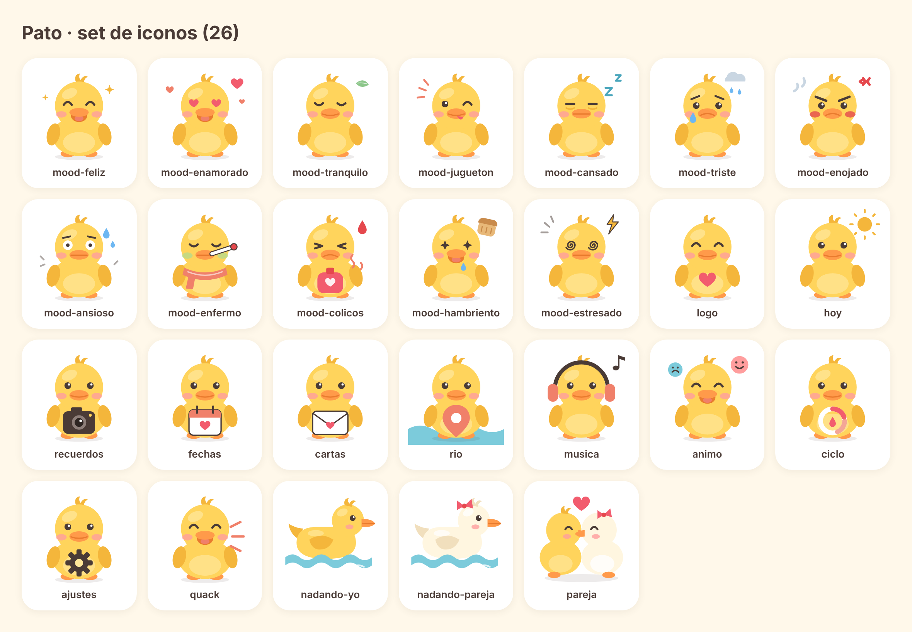

# Pato para iOS

App nativa en SwiftUI (iOS 17+) con widgets, sincronización entre la pareja vía Supabase y un set propio de iconos de patos.



## Estructura

```
ios/
  project.yml            Definición del proyecto (XcodeGen genera Pato.xcodeproj)
  Config/                Pato.xcconfig + Secrets.xcconfig (local, no se sube)
  PatoCore/              Paquete Swift sin UI: modelos, ciclo, río, almacén. Con pruebas.
  Shared/                Código que usan la app y los widgets (paleta, río)
  Pato/
    App/                 Arranque, AppModel (estado + sincronización), componentes
    Features/            Hoy, Recuerdos (álbum/fechas/cartas), Río, Ánimo, Nosotros
    Services/            Supabase, ubicación, Spotify (PKCE), Salud, fotos
    Resources/           Assets.xcassets (icono + patos en SVG)
  PatoWidgets/           Widgets "El río" y "Días juntos"
  tools/                 Generador de los patos (node)
supabase/migrations/     Esquema, RLS y bucket de fotos
```

Misma idea de capas que la web: `PatoCore` es dominio + casos de uso puros; `Services` es infraestructura; `Features` es presentación.

## Compilar

Sin Mac: cada push a un PR corre `.github/workflows/ios.yml`, que prueba `PatoCore` en Linux y compila app + widgets para el simulador en un runner macOS.

Con Mac:

```bash
brew install xcodegen
```

```bash
cd ios && xcodegen generate && open Pato.xcodeproj
```

## Conectar el backend (Supabase)

Sin configuración la app funciona en **modo local** (todo se guarda en el teléfono). Para vincular dos teléfonos:

1. Crea un proyecto en Supabase y ejecuta `supabase/migrations/20261111000000_pato_ios.sql` en el SQL Editor.
2. En *Authentication → Email Templates → Magic Link*, incluye `{{ .Token }}` en el correo: la app pide el código de 6 dígitos, no un enlace.
3. Copia `Config/Secrets.example.xcconfig` como `Config/Secrets.xcconfig` y completa host y anon key.

Spotify (opcional): crea una app en el dashboard de Spotify, registra el redirect `pato://spotify-callback` y pon el Client ID en `Secrets.xcconfig`. No hace falta client secret (se usa PKCE).

## Privacidad (decisiones de diseño)

- **Ubicación**: apagada por defecto, cada quien la enciende y la pausa cuando quiera. Solo la ve la pareja (RLS).
- **Ciclo**: las fechas del periodo nunca salen del teléfono de quien las registra. A la pareja solo le llega un resumen (fase, y opcionalmente días) si esa persona lo activa.
- **Flo**: no tiene API pública. La vía soportada es Apple Health: si la persona activa en Flo la sincronización con Salud, el botón "Traer de Salud" importa los inicios de periodo (HealthKit, solo lectura).

## Regenerar los patos

```bash
node ios/tools/generate-ducks.mjs
```

Edita `ios/tools/generate-ducks.mjs` para agregar estados de ánimo o accesorios; el script reescribe `Assets.xcassets/Ducks`. `render-preview.mjs` (requiere Playwright) regenera la hoja de vista previa y el icono de la app.
